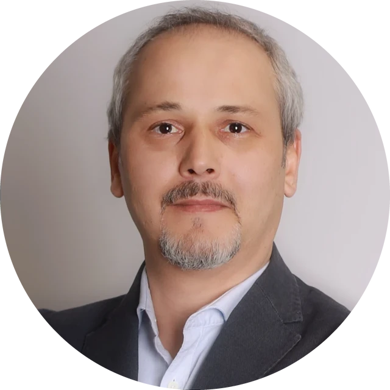

  

    
    
  

  

    
I'm an engineering leader with over 20 years of experience in software development and more than a decade in engineering management.

    
I build product-focused engineering organizations: autonomous teams, clear career and performance frameworks, and delivery processes that make outcomes predictable.

    
My recent work spans Industry 4.0, where I led IIoT, data collection, monitoring and MES products for global manufacturers, and AI engineering, where I design and build production-grade agentic AI systems.

  

## Current Focus

My current focus is making AI-assisted and agentic software reliable in production. I write regularly about these topics on this blog:

* **Harness engineering** and **AI engineering FinOps** ([read more]())
* **Spec-driven development** ([read more]())
* **Agent safety and governance** ([read more]())
* **AI engineering provenance** ([read more]())

## Books

I'm particularly interested in the gap between software teams and the rest of the organization, which I explore in my latest book.

* **[Kodun Ötesi: Yazılım Takımları ve Organizasyonel Gerilim](https://kodunotesi.github.io/)** (2026). Why software teams so often end up at the center of organizational conflict, and how to build healthier organizations around them. Free to read online, in Turkish.
* **[Git ile Versiyon Kontrolü](https://www.dikeyeksen.com/products/git-ile-versiyon-kontrolu)**. Printed book, Dikeyeksen.
* **[F# ile Fonksiyonel Programlama](https://www.dikeyeksen.com/products/f-ile-fonksiyonel-programlama)**. Printed book, Dikeyeksen.
* **Git 101**. Open source book in Turkish ([Read Online](https://aliozgur.gitbook.io/git101/) \| [Download PDF](https://www.dropbox.com/s/947k3c4rvid0drr/aliozgur_git101_book.pdf?dl=0)).

## Community

I founded [apprenti.dev](https://apprenti.dev/), an open platform for mentoring junior developers in the AI era. I wrote about why this matters in [AI Çağında Junior Geliştiricileri Kaybetmemeliyiz](). I also maintain and contribute to a number of [open source projects](https://github.com/aliozgur).

I co-host **Developer Kahvesi**, a Turkish podcast on software development, with Barış Akın and Ertan Tike ([Listen on Spotify](https://open.spotify.com/show/4Sk87o2ftIkOUw3lDNJs7F)).

## Education

* B.Sc. Computer Engineering, Istanbul Technical University
* MBA, Istanbul Bilgi University
